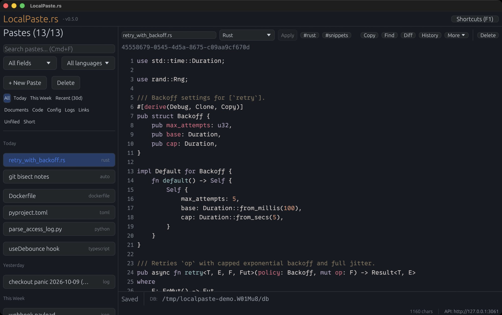

# LocalPaste.rs

LocalPaste stores technical text locally for editing, search, diff, and version recovery.

> [!TIP]
> The recommended way to get LocalPaste is to download the latest release for your operating system from [GitHub Releases](https://github.com/pszemraj/localpaste.rs/releases).



Pastes can be code snippets, logs, stack traces, config fragments, prompts, queries, links, or notes. The GUI detects each paste's language and highlights it. Sidebar search can be limited to titles, metadata, or body text, and smart filters (Today, Code, Config, Logs, and others) with a language filter narrow the list.

`Ctrl/Cmd+K` opens a command palette, and `Ctrl/Cmd+Shift+K` opens a picker that finds a paste by name or content and opens, copies, or deletes it. Each paste keeps earlier versions that can be browsed in History, compared in Diff, and restored, and a deletion can be undone for a few seconds.

It is local-first by design. The desktop app is the main workspace, backed by an embedded database on your machine. A localhost API and the `lpaste` CLI can use the same store, so terminal capture, scripts, and the GUI can fit into one workflow without sending sensitive material to a cloud pastebin.

> [!WARNING]
> Follow the [storage operational expectations](docs/storage.md#operational-expectations) when combining GUI, server, and CLI workflows.

## Quick Start

Download the latest binary for your system from [GitHub Releases](https://github.com/pszemraj/localpaste.rs/releases), then install and run LocalPaste; [GUI releases](docs/release-gui.md) lists artifact names and platform installation details.

Source builds need Git, Rust with Cargo (with rustup, the checkout's `rust-toolchain.toml` selects and installs 1.89.0), and a native C/C++ build toolchain. Linux builds also need `pkg-config` and OpenSSL development headers (`libssl-dev` on Debian and Ubuntu, `openssl-devel` on Fedora).

```bash
git clone https://github.com/pszemraj/localpaste.rs.git
cd localpaste.rs
rustc --version
cargo --version
cargo run
```

In the GUI, the quickest way to keep something is to paste it: copy text anywhere, switch to LocalPaste, and press `Ctrl/Cmd+V`. Unless the editor or another text field has focus, the clipboard becomes a new paste in the sidebar. `Ctrl/Cmd+Shift+V` adds the clipboard to the open paste instead. `Ctrl/Cmd+N` starts an empty paste, and `F1` lists every shortcut.

For a double-clickable macOS app that you can keep in the Dock, see [Build a local Mac app](docs/release-gui.md#build-a-local-mac-app).

Default GUI/server builds use Magika; see [detection build options](docs/language-detection.md#feature-topology) if ONNX Runtime is unavailable on your platform.

## Server And CLI

`lpaste` and the standalone server are not part of the release downloads. From a source checkout, install both into Cargo's binary directory (`~/.cargo/bin` by default):

```bash
cargo install --locked --path crates/localpaste_server --bin localpaste
cargo install --locked --path crates/localpaste_cli --bin lpaste
```

With no GUI open on the same database, run the server in one terminal and use the CLI from another:

```bash
# Terminal A: serve on the default local endpoint, 127.0.0.1:38411
localpaste

# Terminal B: create and list pastes
echo "hello from quickstart" | lpaste new --name "quickstart"
lpaste list --limit 5
```

An open GUI serves the same API itself, so run only `lpaste`. See [CLI workflows](docs/cli-gui-workflows.md) for how `lpaste` finds the GUI and for more examples, and [deployment](docs/deployment.md) to run the server as a background service.

## Documentation

The [documentation map](docs/README.md) links the guides for CLI workflows, storage, security, deployment, and development.

## License

MIT
