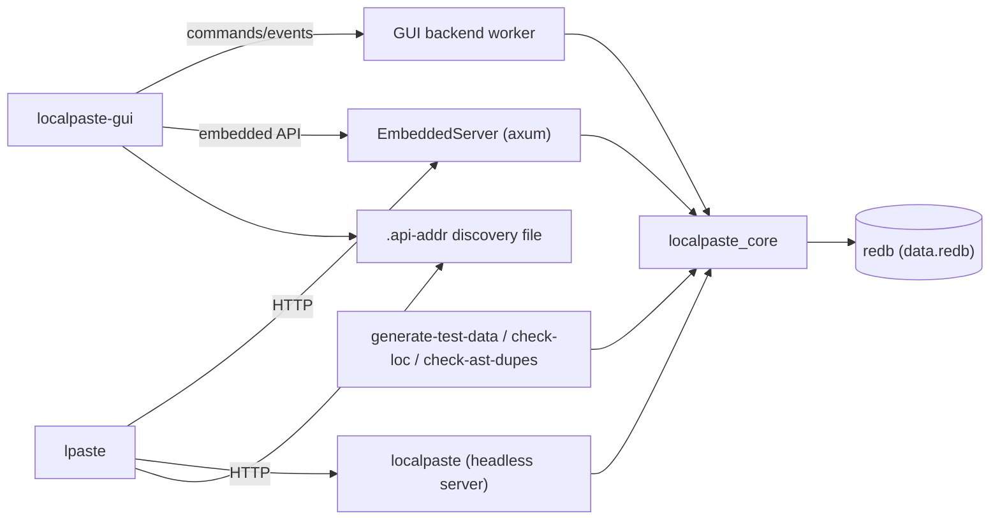
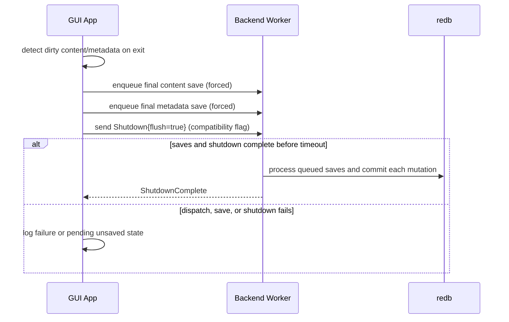
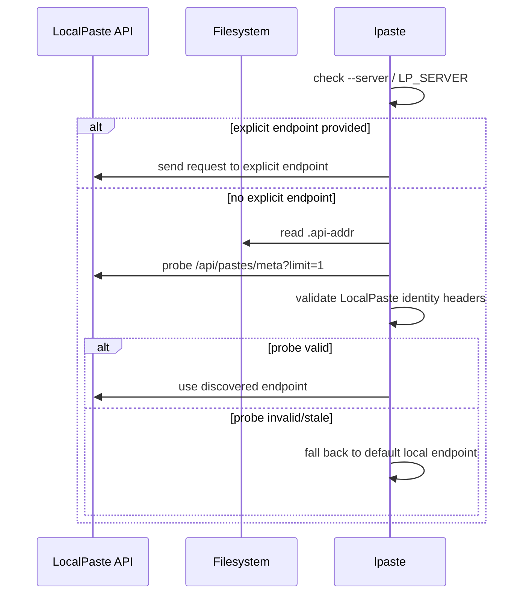

# LocalPaste Architecture

---

- [1) System At A Glance](#1-system-at-a-glance)
- [2) Runtime Topologies](#2-runtime-topologies)
- [3) Storage Design](#3-storage-design)
- [4) Consistency Model](#4-consistency-model)
- [5) Read And Write Paths](#5-read-and-write-paths)
- [6) Locking And Concurrency](#6-locking-and-concurrency)
- [7) HTTP Layer And Security Boundaries](#7-http-layer-and-security-boundaries)
- [8) Language Detection And Highlighting](#8-language-detection-and-highlighting)
- [9) GUI Save Pipeline](#9-gui-save-pipeline)
- [10) Discovery And Trust](#10-discovery-and-trust)
- [11) Validation Strategy](#11-validation-strategy)

## 1) System At A Glance

LocalPaste is a local-first paste manager: one core library shared by several frontends.

| Crate | Binaries | Role |
| --- | --- | --- |
| [`localpaste_core`](../crates/localpaste_core) | library only | Config, models, storage, transaction helpers, invariants, detection and classification |
| [`localpaste_gui`](../crates/localpaste_gui) | `localpaste-gui` | Desktop app and primary interface: app shell, backend worker, editor flows, embedded API |
| [`localpaste_server`](../crates/localpaste_server) | `localpaste` | Headless HTTP API for automation; Axum routing, middleware, handlers, and the embedded server helper |
| [`localpaste_cli`](../crates/localpaste_cli) | `lpaste` | HTTP client that can discover the GUI's embedded API |
| [`localpaste_tools`](../crates/localpaste_tools) | `generate-test-data`, `check-loc`, `check-ast-dupes` | Test fixtures, line-count policy, duplicate and dead-symbol audit |

## 2) Runtime Topologies

### GUI-Primary Topology

`localpaste-gui`:

1. Acquires the process-lifetime owner lock at `DB_PATH`.
2. Opens the database.
3. Starts the embedded API on `BIND` or loopback `PORT`, falling back to a free port when that one is taken.
4. Writes embedded API endpoint to `DB_PATH/.api-addr`.
5. Runs UI and backend worker in-process.

CLI endpoint selection follows [Discovery And Trust](#10-discovery-and-trust).

### Headless Topology

`localpaste`:

1. Acquires the process-lifetime owner lock at `DB_PATH`.
2. Opens the database.
3. Binds HTTP listener (`BIND` or loopback default).
4. Serves API requests until shutdown.

DB ownership rules for both topologies are in [storage.md#operational-expectations](storage.md#operational-expectations).

## 3) Storage Design

The core persists [paste rows, projections, and version history](storage.md) in redb.

- [`../crates/localpaste_core/src/db/mod.rs`](../crates/localpaste_core/src/db/mod.rs)
- [`../crates/localpaste_core/src/db/paste/mod.rs`](../crates/localpaste_core/src/db/paste/mod.rs)
- [`../crates/localpaste_core/src/db/folder.rs`](../crates/localpaste_core/src/db/folder.rs)

## 4) Consistency Model

The [storage atomicity contract](storage.md#durability-and-atomicity) applies to paste, metadata, recency-index, and folder updates.

Core transaction helper:

- [`../crates/localpaste_core/src/db/transactions.rs`](../crates/localpaste_core/src/db/transactions.rs)

Folder shared operations and invariant repair:

- [`../crates/localpaste_core/src/folder_ops.rs`](../crates/localpaste_core/src/folder_ops.rs)

## 5) Read And Write Paths

Write surfaces:

- API handlers (`localpaste_server`),
- GUI backend worker (`localpaste_gui`),
- tooling (`localpaste_tools`).

Folder API pathways remain for compatibility and emit deprecation headers; the GUI organizes pastes through smart filters and search. Folder assignment/delete invariants stay in shared core helpers so API and GUI backend paths enforce equivalent behavior.

Version and diff surfaces:

- `/api/paste/:id/versions*` supports list/get/reset-hard/duplicate for historical snapshots.
- `/api/diff` and `/api/equal` compare head or historical paste references. Distinct references with combined content above 1 MiB return `413 Payload Too Large`; identical references resolve existence and return equality without that size gate.
- Content-changing writes may persist an older-head snapshot. Snapshot interval and retention behavior are defined in [storage.md#version-history-storage](storage.md#version-history-storage).

Read behavior:

- List and search responses contain metadata rows; fetch `/api/paste/:id` for full content.
- Lists read metadata and recency projections backed by atomic write consistency.
- The API searches All fields (`/api/search`) or Metadata (`/api/search/meta`); the GUI adds Title and Body scopes. Title and Metadata read only the projection, while All fields and Body also read paste bodies. Every scope filters and ranks the full store before applying the result limit; metadata matching follows [filter and search semantics](language-detection.md#filter-and-search-semantics).
- Projection updates commit with authoritative writes; reads need no stale-index fallback.

## 6) Locking And Concurrency

See the [lock layers and mutation guards](dev/locking-model.md).

## 7) HTTP Layer And Security Boundaries

Axum router and middleware live in:

- [`../crates/localpaste_server/src/lib.rs`](../crates/localpaste_server/src/lib.rs)

HTTP requests use [loopback binding, size limits, and browser security headers](security.md).

## 8) Language Detection And Highlighting

The core [detects and normalizes languages](language-detection.md#detection-flow); the GUI [resolves grammars and stages highlighting](language-detection.md#gui-highlight-resolution).

## 9) GUI Save Pipeline

The GUI uses a command/event backend worker so UI rendering stays non-blocking.

Key properties:

- autosave and keyboard-triggered manual saves dispatch through backend commands,
- metadata save path is separate from content save path,
- shutdown attempts to drain saves, enqueue final dirty snapshots, and wait for the backend to finish; editor input accepted for a paste that is still loading waits for that load and is saved with the rest. Failures and timeouts are logged, so this is best effort.

Relevant code:

- [`../crates/localpaste_gui/src/app/state_ops.rs`](../crates/localpaste_gui/src/app/state_ops.rs)
- [`../crates/localpaste_gui/src/app/shutdown.rs`](../crates/localpaste_gui/src/app/shutdown.rs)
- [`../crates/localpaste_gui/src/backend/worker.rs`](../crates/localpaste_gui/src/backend/worker.rs)

## 10) Discovery And Trust

`lpaste` resolves its endpoint as follows; [CLI workflows](cli-gui-workflows.md#connect-to-the-running-gui) covers the flags that pin or disable discovery.

Discovered endpoints must use HTTP with a loopback host and return `200` from `/api/pastes/meta?limit=1` with JSON content type, `X-Content-Type-Options: nosniff`, `X-Frame-Options: DENY`, and `x-localpaste-server: 1` headers.

The probe uses 250 ms connection/read/write timeouts. These checks reject stale or unrelated endpoints; the headers identify a compatible API but do not authenticate a local process.

Relevant code:

- [`../crates/localpaste_server/src/embedded.rs`](../crates/localpaste_server/src/embedded.rs)
- [`../crates/localpaste_cli/src/discovery.rs`](../crates/localpaste_cli/src/discovery.rs)

## 11) Validation Strategy

- [dev/devlog.md#validation-loop](dev/devlog.md#validation-loop)
- [dev/devlog.md#runtime-smoke-test-server-cli](dev/devlog.md#runtime-smoke-test-server-cli)
- [dev/gui-notes.md#manual-gui-human-step-checklist-comprehensive](dev/gui-notes.md#manual-gui-human-step-checklist-comprehensive)
- [dev/gui-perf-protocol.md](dev/gui-perf-protocol.md)
