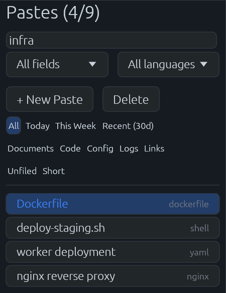
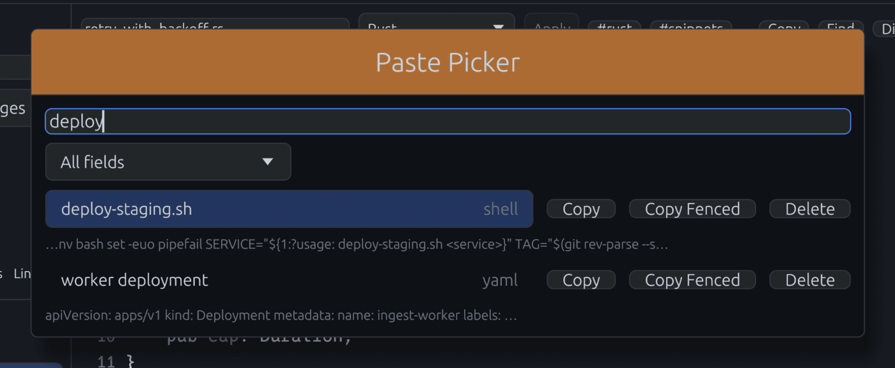
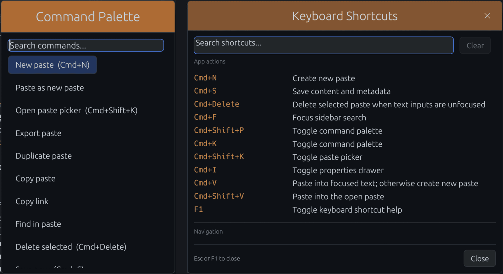
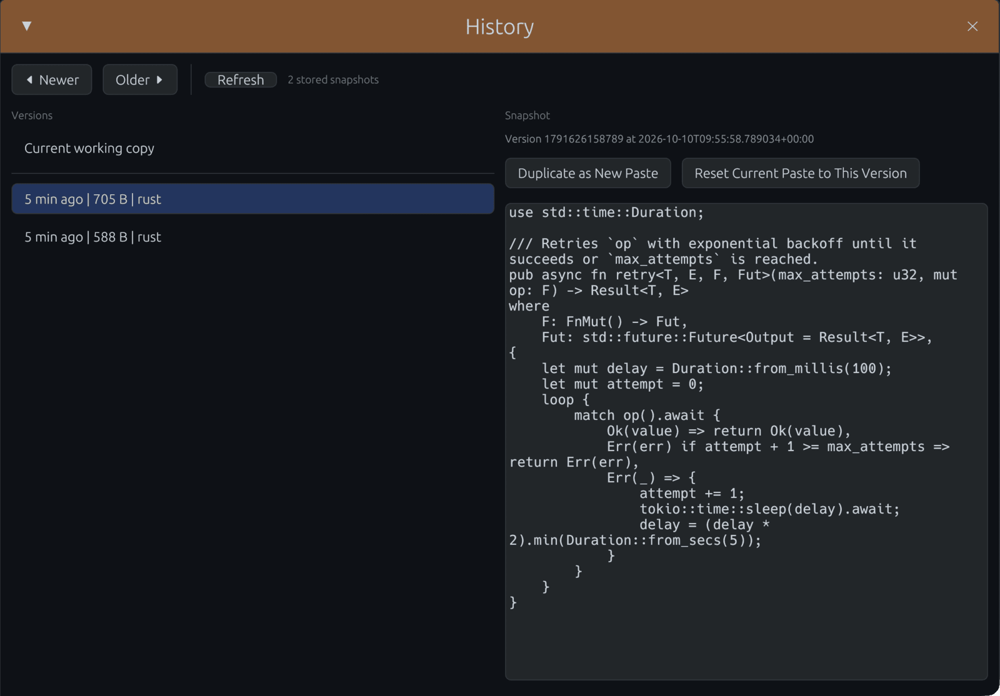
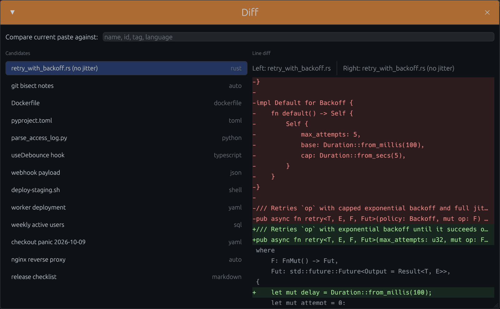

# GUI Notes

Detection, normalization, and highlighting are in [language-detection.md](../language-detection.md); perf validation steps and gates are in [gui-perf-protocol.md](gui-perf-protocol.md).

## Runtime Flags

- `EGUI_INSPECTION=1`: opt in to egui's inspection server at `127.0.0.1:5719` for widget-tree reads, clicks, typing, and screenshots through the egui MCP server. Inspection stays off when unset. Use a disposable `DB_PATH` and an unused API `PORT` when driving the app; inspection actions change the running GUI and its database.
- `LOCALPASTE_EDITOR_PERF_LOG=1`: periodic local frame snapshots (`avg/p50/p95/p99/worst`) plus list/search and redo-cache counters.
- `LOCALPASTE_BACKEND_PERF_LOG=1`: local backend list/search cache hit/miss and latency logs.
- `LOCALPASTE_EDITOR_INPUT_TRACE=1`: virtual input routing trace.
- `LOCALPASTE_HIGHLIGHT_TRACE=1`: highlight request/apply/drop lifecycle trace.
- `LOCALPASTE_LOG_FILE=<path>`: append GUI tracing logs to a file (useful on Windows release builds where no console is shown).
- `LOCALPASTE_LINUX_DESKTOP_ENTRY=force|off`: Linux-only desktop-entry setup override. `force` writes the managed user entry; `off` (also `0`, `false`, `no`, `skip`, `disable`, `disabled`) disables desktop-entry setup for isolated probe or test launches.
- `LOCALPASTE_NAV_PROBE_LOG=<path>`: enables per-frame NDJSON navigation probe logging.
- `LOCALPASTE_NAV_PROBE_SCENARIO=<id>`: labels probe frames for runner assertions.
- `LOCALPASTE_NAV_PROBE_SEED_TEXT=<text>`, `LOCALPASTE_NAV_PROBE_SEED_NAME=<name>`, `LOCALPASTE_NAV_PROBE_SEED_CURSOR=<char|line:col>`: seed the disposable in-memory probe paste and initial caret.
- `LOCALPASTE_NAV_PROBE_FOCUS_EDITOR=1`: requests initial virtual-editor focus until the active native window acquires it; later focus changes follow normal app behavior. Only `1` and `true` enable it.
- `LOCALPASTE_NAV_PROBE_CLEAR_SELECTION=1`: with probe logging enabled, clears the first loaded startup selection once while retaining sidebar rows, so native paste tests can exercise the no-open fallback. Later selection and paste follow normal app behavior.
- `LOCALPASTE_NAV_PROBE_PYTHON=<path>`: runner/assertion Python executable override.
- The perf and trace flags (`LOCALPASTE_EDITOR_PERF_LOG`, `LOCALPASTE_BACKEND_PERF_LOG`, `LOCALPASTE_EDITOR_INPUT_TRACE`, `LOCALPASTE_HIGHLIGHT_TRACE`) accept `1`, `true`, `yes`, `on` and `0`, `false`, `no`, `off` (case-insensitive, whitespace trimmed). An unrecognized value logs a warning and counts as false.

## Keyboard And Navigation Contract

Shortcut contract:

- `Ctrl/Cmd+N`: create/select new paste.
- `Ctrl/Cmd+S`: save content + metadata.
- `Ctrl+Delete` (Windows/Linux) or `Cmd+Backspace` / `Cmd+Delete` (macOS): delete selected paste when no text input (editor, title, search, picker or palette query, or any other field) owns focus and no popup (a combo list such as the language selector, or a menu such as `More`) is open; in a field the chord keeps its text-editing meaning (`Cmd+Backspace` deletes to line start), and under a popup it does nothing. `Delete` means forward Delete. `Ctrl+Backspace` is word deletion on Windows/Linux and never deletes the paste.
- `Ctrl/Cmd+F`: focus sidebar search.
- `Ctrl/Cmd+K`: toggle the commands-only palette (also `Ctrl/Cmd+Shift+P`).
- `Ctrl/Cmd+Shift+K`: toggle the separate paste picker.
- `Ctrl/Cmd+I`: toggle Properties drawer.
- `F1`: toggle shortcut help; search descriptions or key combinations (for example `picker` or `Cmd+Shift+K`).
- `Ctrl/Cmd+A/C/X/Z/Y`: standard virtual-editor select-all/copy/cut/undo/redo when editor owns focus. Undoing a cut, a deletion, or text typed or pasted over a selection reselects the restored text in its original direction. Undo history keeps up to 500 steps and 8 MiB of removed and inserted text, dropping the oldest steps first; the newest step is always kept, so one larger edit, such as indenting or replacing all of a multi-megabyte paste, stays undoable but displaces every earlier step.
- `Ctrl/Cmd+Shift+Z`: redo editor edit when editor owns focus.
- Windows `Shift+Delete`, including `Ctrl+Shift+Delete`, cuts the editor selection; with no selection it leaves the buffer unchanged. `Ctrl+Delete` deletes the next word. The [egui-winit 0.36.2 clipboard mapping](https://github.com/emilk/egui/blob/0.36.2/crates/egui-winit/src/lib.rs) consumes the shifted Delete press as a Cut event; Linux retains forward word deletion for `Ctrl+Shift+Delete`.
- `Ctrl/Cmd+V`: pastes into the focused editor or text field. With nothing focused, the clipboard becomes a new paste and the editor takes focus with the caret after the text, so a second paste goes into it. Clipboard text that is only whitespace creates nothing, and a toast says so. Switching away from the app releases editor focus, so the first paste after switching back creates a new paste.
- `Ctrl/Cmd+Shift+V`: in the focused editor, pastes at the caret like `Ctrl/Cmd+V`. From anywhere else, including the title, sidebar search, nothing focused, or just after switching back to the app, it appends the text to the open paste on a new last line, then focuses the editor with the caret after it. A paste that is still loading receives the text once it loads, so placement never depends on load timing; the same holds for a paste just clicked while the previous one is still saving, which never receives the text. With no paste open, the text is appended to the top sidebar paste once it loads, and presses made before then follow it in order; with no pastes, it becomes a new one. Presses that reach the app in one input batch append every payload in press order, as separate presses do. The palette, picker, and help keep the text for their own query field. The palette's `Paste as new paste` action is the explicit way to create a paste.

egui-winit delivers these chords as a Paste event without a V press. LocalPaste consumes the ordered `ModifiersChanged` events and stages each paste's chord before deferred picker, palette, or help input is split across frames. Releasing Ctrl/Cmd or Shift in the same native batch therefore preserves the routing above. Native deactivation clears the carried modifier state. The backend still rewrites `\r\n` in clipboard text to `\n`, so every clipboard paste stores LF line endings; text saved through the API or CLI keeps its own.

The sidebar's resize edge can be dragged closed or double-clicked to collapse it, and dragged from the left edge to reopen it. `Ctrl/Cmd+F` also reopens it and focuses search. Find's label and match count are decorations inside the query field; Escape closes Find and returns focus to the editor.

Focus ownership: the virtual editor keeps the keyboard until the window loses native focus, a text field or discovery surface takes focus, or a click lands outside it (editor toolbar actions that preserve focus excepted). Native deactivation first applies the text and paste events that arrived earlier in the same frame, then releases editor focus while keeping the selection. When a frame carries several focus events the last one decides, so a deactivate-and-reactivate pair keeps editing. While unfocused, `Ctrl/Cmd+C` still copies the editor selection if no other text input has focus, `Ctrl/Cmd+V` creates a new paste, and a click on the editor resumes editing. Uncommitted IME composition is canceled on deactivation and when a discovery surface takes focus, restoring the displaced text and selection; a later commit is one undoable replacement of the original selection.

Navigation/selection contract:

- `Up`/`Down` move the sidebar selection only as bare arrows while neither the editor nor a text input owns the keyboard and no overlay, combo list, or menu is open, so arrows pressed with a language popup open never switch pastes or save its type-ahead choice; if the selected paste is not in the visible list, the first press selects the first visible row. Arrows with `Ctrl`/`Alt`/`Shift`/`Cmd` stay with editor-selection semantics.
- `Tab` indents each selected line that has non-whitespace content by four spaces, and inserts four spaces at a single caret. `Shift+Tab` removes one leading tab or up to four spaces from each affected line. A partial single-line selection indents the whole line, directional selections survive indentation and undo/redo, and each indentation is one undo step.
- Shift-click and Shift-drag extend the editor selection from its existing anchor using the modifiers captured at mouse press, even if Shift is released before the mouse. Clicks on floating windows, including their edges, leave the underlying caret and selection untouched.
- Virtual wrapped-row navigation preserves wrap-boundary intent across vertical movement (boundary affinity handling).
- CRLF is one navigation boundary: Left/Right and shifted selection cross both characters without placing the caret between them. Edits and undo/redo keep the caret on a visible position and preserve unedited line endings.
- Over-wide glyph wrapping (emoji/CJK in very narrow viewports) consumes at least one glyph per row to avoid blank visual rows.
- A tab is drawn four spaces wide with no tab stops, and wrapping, column mapping, and vertical caret movement count it the same way, so a tab-indented line wraps inside the editor instead of running past its right edge.

## Navigation Probe

The navigation probe writes per-frame NDJSON for native keyboard focus and caret checks: actual viewport and caret bounds, visible-caret status, Find focus, and scroll offset, so contracts assert visibility as well as cursor indices. The OS-specific runner scripts set the probe environment variables listed in [Runtime Flags](#runtime-flags); set them directly only for local debugging or manual Wayland checks.

- Scenario contract: [nav_contract.json](nav_contract.json)
- Assertion checker: [../../tools/nav_probe_assert.py](../../tools/nav_probe_assert.py)
- Linux X11 runner: [../../tools/nav_probe_run_linux_x11.sh](../../tools/nav_probe_run_linux_x11.sh)
- macOS runner: [../../tools/nav_probe_run_macos.sh](../../tools/nav_probe_run_macos.sh), with the `paste_*` helper [../../tools/nav_probe_paste_macos.py](../../tools/nav_probe_paste_macos.py)
- Windows runner: [../../tools/nav_probe_run_windows.ps1](../../tools/nav_probe_run_windows.ps1)

For navigation scenarios each runner launches a disposable probe DB under `target/`, seeds the editor, waits for a probe frame showing virtual-editor keyboard focus, injects native key chords, and writes NDJSON evidence. The GUI process is terminated after the evidence frame by default (Windows `-GracefulShutdown` opts out), so normal window-close shutdown races cannot fail a probe run. Run a runner with `--help` (`Get-Help tools\nav_probe_run_windows.ps1` on Windows) for scenario selection, timing, and repeat options; `--list` (`-List` on Windows) prints the scenarios that would run. Windows runs also write a `*.manifest.json` beside the log, which `-Assert` verifies; `python tools/nav_probe_assert.py --help` lists the options for re-verifying a saved bundle.

Linux automation is X11-only and requires `xdotool`; Wayland must be checked manually with the same probe environment variables because compositor policy restricts synthetic input. The runner sets `LOCALPASTE_LINUX_DESKTOP_ENTRY=off` so contract runs do not touch user desktop-integration paths, and defaults to `LIBGL_ALWAYS_SOFTWARE=1` and `WGPU_BACKEND=gl` to avoid host GPU/EGL startup noise; set either variable beforehand to override.

```bash
tools/nav_probe_run_linux_x11.sh --build --assert --only ctrl_home_from_middle
tools/nav_probe_run_linux_x11.sh --assert --summary
```

macOS automation requires Accessibility permission for the terminal running the script, because native key injection goes through the Swift/CoreGraphics helper built from `tools/nav_probe_macos_driver.swift`.

```bash
tools/nav_probe_run_macos.sh --build --assert --only cmd_up_from_middle --summary
tools/nav_probe_run_macos.sh --build --assert --summary
```

macOS `paste_*` scenarios use persisted fixtures and the `LocalPasteReview` test bundle, with a fresh temporary `DB_PATH`, unused port, and explicit `LP_SERVER`. The helper types and pastes through native events, reads bodies and metadata through the embedded API, and checks them again after restarting the GUI. App switch scenarios use `Cmd+Tab` and copy synthetic text from a new Safari window; Safari must already be running. Only that window is closed. Every clipboard item and representation is privately backed up and restored byte for byte, unless outside clipboard activity has superseded the test copy.

Use `--key-delay-ms 80` for a normal held chord or `--key-delay-ms 0` for rapid release. `--capture` pauses at each paste result so a screenshot can be taken: the runner writes `<log stem>.capture.json` beside the log with the scenario and isolated endpoint, and resumes when `<log stem>.continue` appears. Completed paste results are recorded alongside native frames in NDJSON, including full synthetic API readback and restart equality. An unmet native precondition remains a failed assertion; it is never silently replaced by an in-memory test. The no-open case uses the one-shot probe setup flag because ordinary startup automatically opens the first available paste.

Windows automation runs from Windows PowerShell 5.1 or PowerShell 7 and sends navigation chords through low-level `SendInput`; `-UseSendKeys` is a fallback for debugging the driver itself.

```powershell
tools\nav_probe_run_windows.ps1 -Build -Assert -Only ctrl_home_from_middle
tools\nav_probe_run_windows.ps1 -Build -Assert -Summary
```

Use `python tools/nav_probe_assert.py --check-spec docs/dev/nav_contract.json --windows-runner tools/nav_probe_run_windows.ps1 --self-test` to lint scenario ids, driver chord syntax, macOS key-code entries, Windows runner key support, and manifest-completeness checks without launching the GUI.

## Stable Behavior Notes

### Sidebar and filters



Sidebar rows are virtualized and grouped under Today, Yesterday, This Week, and Earlier headers by last update; the headers are omitted while a search query is active. Each row is a single full-width click target showing the title and a right-aligned language label, and the label follows the large-buffer plain-rendering rule. The title may use the row's full width up to a small gap before the label; a longer title ends in an ellipsis there instead of being cut off or running under the label. The paste picker and Diff candidates show the same label, so a paste reads the same in every list. The list is a metadata projection of every paste, so the header count is the store's total and scrolling reaches the oldest paste; scoped sidebar and paste-picker searches likewise return metadata summaries rather than full bodies. Without a search query, smart and language filters narrow those rows; a search applies them in the backend before its result limit. When the selection changes by any route (arrow keys, the picker, palette actions, a new paste, or startup restore), the list scrolls just enough to show the selected row, with its date header when it is the first row of a group. The same reveal runs once when a change of the search query, search scope, smart filter, or language filter has replaced the rows, on the first frame that shows the new rows (for a search, once its reply arrives), so clearing a search or returning to All keeps the selected paste in view; a selection the new rows leave out is revealed by a later change that lists it again. Manual scrolling stays where it is left until the selection or the filters change again: refreshes, external writes, saves, and renames under unchanged filters never move the list.

Within each date group, sidebar spacing follows the observed gaps between neighbouring modification timestamps. The median gap in that group describes its usual pace: rows no further apart than the median stay compact, while larger pauses receive progressively more whitespace, up to 12 points (`MAX_CLUSTER_GAP` in [`sidebar/list.rs`](../../crates/localpaste_gui/src/app/ui/sidebar/list.rs)), so even the longest pause stays a modest break rather than an empty row. The relative extra space is `(gap - median) / (gap + median)` for gaps above the median. There is no cutoff in minutes or days and no dependence on a paste's age; shifting an entire group's timestamps into the past or scaling all its intervals preserves the spacing. Equal timestamps stay together, and uniformly spaced rows remain uniform. A date header already separates groups, so no extra space sits next to one. Search results are in relevance order and get no temporal spacing; smart and language filters compute spacing from the rows they show. Extra whitespace stays empty and unclickable, and scrolling and selection reveal account for its actual size.

The search scope and language filter share one row under the search field, each half the sidebar width. The language filter appears once any paste has a language, always offers an explicit `All languages` entry, and stacks with the active smart filter instead of replacing it. Smart filters render as compact chips in three rows: time windows (All, Today, This Week, Recent (30d)), then content kinds (Documents, Code, Config, Logs, Links), then Unfiled and Short. The chips name their own filters, so no heading sits above them, and the minimum window still shows six list rows. Each row fits the default sidebar width with room to spare at display scales from 100% to 200% and wraps when the sidebar is narrowed, so every filter stays visible and one click away. Classification, including the Documents grouping of Markdown, reStructuredText, LaTeX, and prose notes and the Short filter for pastes too short to classify, follows [filter semantics](../language-detection.md#filter-and-search-semantics).

Empty filter results never discard work in progress: unsaved content, unsaved metadata, and pending saves keep their paste and edit lock until saving completes. Selecting the already-active paste cancels a queued switch to another, and a repeated load reply cannot overwrite an initialized editor draft.

The app's own edits update the list immediately. Writes through the embedded API, such as from `lpaste`, appear in the list when the window regains focus (at most once every 2 seconds) and otherwise within 30 seconds of the previous refresh, even while the window sits idle. Each refresh also reruns an active sidebar search, so its results follow body writes the metadata list cannot show.

### Editor

The editor toolbar is a single row. Title, language, Apply, and up to three tag chips sit on the left; further tags, or tags that do not fit, collapse into a `+N` chip that lists every tag on hover and opens Properties. Clicking a tag chip searches the sidebar for that tag. Copy, Find, Diff, History, a `More` menu (Copy Link, Duplicate, Export, Properties), and Delete sit on the right. When the editor is too narrow for both groups, counting room for a `+N` chip whenever the paste has tags, the actions move to a second row, so tags never vanish without a chip or count. Either group wraps within the editor when it is too wide for a row of its own, as with Properties open in the minimum window, so every control stays visible and clickable. Title edits commit on `Enter` and on title-field blur. A metadata save sends the language only when the draft changes it, so a language that content autosave detects while a title or tag edit is open stays saved and shows in the toolbar. `Escape` in the title, or in the Properties Name or Tags field, cancels the edit: the field returns to the text it had when it gained focus, loses focus, and saves nothing, and metadata stays dirty only for edits made elsewhere, such as a staged language change. While a language popup (toolbar or Properties) is open, typing selects an option by type-ahead. Typed characters collect into a buffer that starts over after one second without typing and whenever the popup closes; whitespace is ignored, while symbols count, so `c#` and `c+` reach C# and C++. The buffer selects the first option whose label starts with it, ignoring case: `py` selects Python, `javas` JavaScript, `sh` Shell, and `sq` SQL, and spelling a name out stays on it. Repeating one character cycles through the options starting with it and wraps (`p`, `p`, `p` gives Perl, Plain text, PowerShell). No language label starts with `a`, so `a` selects Auto. A buffer that matches no label keeps the current choice. The selected option scrolls into view, each change dirties metadata exactly like a click, and the popup stays open for further typing. `Enter` closes the popup and keeps the choice, like a click outside it. A text field or the editor taking focus while the popup is open, such as the palette, picker, or help query opened by its shortcut or the sidebar search focused by `Ctrl/Cmd+F`, also closes it and keeps the choice, so that input alone receives the typing, `Enter`, and `Escape`. `Escape` closes the popup and restores the choice it opened with, or the saved paste's language when that choice staged no change, so a language detected while the popup was open stays; metadata stays dirty only if the draft still differs from the saved paste; a type-ahead change cancelled this way is never saved, including by switching pastes. With the popup closed, typing does not change the language. The Properties drawer holds the expanded metadata fields and is non-modal, so opening it does not disable typing, caret movement, or editor shortcuts. A language label displays as `auto` when automatic detection has not resolved one and as `plain` when the language is manually pinned without a value. The GUI has no folder create, edit, or move controls; organization is by smart filters and search. Virtual-editor highlight debounce and staging policy is defined in [highlighting.md](highlighting.md).

With no paste selected, the editor shows a centered `Select a paste from the sidebar.` message over muted hints for New paste, Paste as new paste, Open a paste (the picker), Command palette, and Keyboard shortcuts. The keys come from the runtime shortcut registry, so they read `Cmd` on macOS and `Ctrl` elsewhere; Command palette shows its primary `Cmd/Ctrl+K` chord, which also keys its row in shortcut help.

Typing and paste reveal the caret with minimal scrolling, including the inserted tail of a multiline paste, and manual scrolling stays where it is left until the next edit or navigation action. Document jumps and Find results center the caret instead, independent of editor focus. Loading another paste resets the viewport to the first line before any search-match reveal, even if the previous paste was scrolled to its end. Virtual rows use zero vertical item spacing so hit testing and scrolling share the rendered row height.

An editor-owned drag keeps extending the selection and autoscrolling outside the viewport or window, foreground overlays retain their pointer ownership, and dragging the scrollbar preserves the selection. A press below the last line anchors the caret at EOF, and dragging from there extends the selection live, as from text. Autoscroll stops requesting scrolls and repaints once the viewport reaches the document start or end, even while the drag stays held past that edge. Native window deactivation ends the drag, because the platform may never deliver its button release (for example, Alt+Tab mid-drag on Windows); the selection made so far is kept, and moving the pointer afterwards does not extend it. The floating scrollbar's hit strip (its hover-expanded width plus the style's outer margin) never counts as an editor row.

In a paste whose current language is Markdown (including the `md` alias), pasting a single HTTP(S) URL over a non-empty selection inserts `[selection](URL)` as one undoable edit; escaping, inline code, and line-break handling live in `format_markdown_link`. Whitespace and line breaks at either end of the selection stay outside the brackets, so a triple-clicked line keeps its trailing newline. Other languages, empty or whitespace-only selections, selections that are themselves URLs, and non-URL clipboard text paste normally, so selecting the destination of an existing link and pasting a URL swaps it rather than nesting a new link.

### Search and paste picker

The sidebar and the paste picker each keep their own query and field scope for the session: All fields (default), Title, Metadata, or Body. While a scope menu is open it owns `Up`/`Down`, which select the neighbouring scope, and `Enter` and `Escape`, which close the menu keeping the choice; the rows and results behind it, and the picker itself, do not react to those keys. Opening the palette, picker, or help closes any menu still open, so the new surface receives those keys. The [search read paths](../architecture.md#5-read-and-write-paths) determine which fields are loaded and ranked. Responses and backend cache keys carry the scope and collection, so delayed results cannot leak between contexts. Debounced searches schedule their own repaint deadline, so a typed query dispatches without further input or focus changes, while pending or failed requests do not create a repaint loop. A sidebar reply that arrives after its query was edited is dropped, and editing back to that query sends it again (for example, typing `abcd` then Backspace before the `abc` results land).

Changing the sidebar scope keeps the existing rows, the open document, and its reading position until replacement results arrive, even when nothing matches. Once a search reply or a filter leaves no rows, the list says `No matching pastes` or `No pastes match these filters`. A failed sidebar search keeps those rows and shows `Retry search`; retrying or changing the query or a filter resumes requests, and a stale failure cannot replace the current query's status.



The paste picker is separate from the command palette: the palette lists actions only (for example Export, Duplicate, Copy, Copy link, Find, Properties, History, and Diff), and the picker lists paste rows. A result opens on click or `Enter` and offers Copy, Copy Fenced, and Delete. While a scoped request is in flight the picker shows `Searching...`; a failure stays visible with a Retry button, requests resume only on Retry or a query or scope change, and a successful response clears the error. Changing the query or scope clears old results immediately. Closing the picker discards its results and resets selection while retaining the query and scope; opening it selects the retained query for replacement and re-dispatches the search, so responses discarded while it was closed cannot leave it empty. Once rows arrive after a reopen or a query or scope change, selection resets to the first result and the list scrolls to the top, after which manual scrolling is preserved. All fields and Body results carry a compact excerpt around the first literal body match; Title and Metadata results are metadata only.

Opening a result focuses its editor after the paste loads. Text and paste input received while the previous draft saves or the chosen body loads is held for the accepted selection and replayed into the editor, including the delete-selected chord, which there keeps its text-editing meaning instead of deleting the paste being opened; a pointer press, `Escape`, another app shortcut, or a failed open discards it. A new paste always opens, even when the current search or filters leave it out of the sidebar. A picker result, new paste, or paste reopened at startup outside the current sidebar results stays selected through background refreshes until the sidebar selection, search query, or collection or language filter changes.

Copying a picker result leaves the editor selection and draft intact. Only the latest copy request is honored: older loaded, missing, or failed replies cannot consume a newer request, even one for the same paste, and a completed copy from the editor, toolbar, a text field, or a selectable label supersedes an older pending picker copy (a copy with no selected text does not).

Deleting a different paste from the picker restores the originating input and keeps the editor draft. Deleting the open paste keeps the picker as keyboard owner, including for typing and paste into its query, and blocks dismissal, discovery toggles, and unrelated selection changes until the delete reply and the replacement paste load settle. A selection queued before the delete is preferred over the adjacent fallback, a save, delete, or load failure releases the block while keeping the picker, and after a successful replacement load `Escape` returns to the originating input.

### Find

Editor-toolbar `Find` searches the open paste body, selects the active match in the virtual editor, and scrolls it into view. Switching pastes with Find open selects the first match of the retained query. Opening a paste from a sidebar or picker All fields or Body search primes the find bar with that query when it appears in the body; picker opens carry their originating query through loading and save-before-switch, including when reopening the active draft, and metadata-only picker hits leave the existing Find query alone. Find and picker excerpts follow the backend's case policy: insensitive ASCII queries fold ASCII only, while other queries lowercase the complete strings and map matches back to whole source characters, including Unicode expansions such as `İ` matching `i` plus a combining dot.

Growing the query refines the current match from its start. Clicking Prev, Next, or Case and pressing `Enter`/`Shift+Enter` keep focus in the query field, with `Enter` and `Shift+Enter` moving to the next and previous match. `Escape` in the query field or `Close` returns focus to the editor, preserving the matched selection and the query for reopening.

### Discovery overlays and help

The palette offers Duplicate once the selected paste body has loaded; it copies the current editor draft, including unsaved edits.



The command palette, paste picker, and shortcut help are mutually exclusive: opening one closes the other two so its query owns keyboard input. `Escape` or the toggle shortcut returns focus to the input that opened discovery, including across switches between surfaces. Focus returns only to a text input or the editor that still renders, so an input removed while discovery was open, such as a Properties field whose drawer closed behind Help, is skipped rather than published as an accessibility focus without a node, and the skipped return never takes focus later. Input batched around a transition stays in order, with earlier text belonging to the previous input and later text to the new destination, and `Enter` on a palette command or picker result processes the preceding query before routing later text. Commands that open another workflow keep their intended focus destination.

A window-close request waits for remaining input slices from discovery transitions, input retained with a loading picker result, and queued paste-into-editor input whose target is still loading to finish in the live UI, then resumes closing and flushes pending saves. This preserves body and metadata edits without inserting discovery-query text into the document, and lets a Cut reach the clipboard before saving its deletion. If input is still waiting after the shutdown-flush timeout, closing is canceled and the input remains queued; try closing again after the paste loads. If exit bypasses that live drain, an unreplayed batch containing a Cut is left unapplied to preserve its source text.

While any of the three is open, background New, Paste into Editor, Save, Delete, sidebar-search focus, and Properties shortcuts are blocked, including delayed `Paste as new paste` clipboard replies; actions chosen inside the palette remain available. [Diff and History](#diff-and-history-workflows) use separate workflow fences. The palette keeps the selected command visible during keyboard navigation and query changes.

The palette and picker query fields, like the Diff window's compare field, fill the width of their row. Palette and picker rows are full-width, so the hover and selection highlight spans the row. Hover is a neutral `COLOR_BG_TERTIARY` fill and the selected row keeps the stronger blue selection fill, even under the pointer, so the row Enter activates stays distinguishable. The same full-width rows and list-row hover apply to the Diff window's candidate list and the History window's version list. Sidebar rows rest on that tertiary fill, so their hover lifts them one step further to `COLOR_BORDER`; the selected sidebar row likewise keeps the selection fill under the pointer. Toolbar buttons keep the orange hover. Palette rows show the command on the left and its shortcut or a short description right-aligned in muted text; the palette query matches both. Picker rows show the paste name with its list language label right-aligned, keep Copy, Copy Fenced, and Delete in a right-aligned column, and truncate long names with an ellipsis.

App-level shortcut dispatch, palette hints, and shortcut help share one runtime shortcut registry, and dispatch preserves native event order, including repeated chords. Help lists the app bindings plus selected navigation, editing, and Find combinations, and omits plain arrow movement and the standard select/copy/cut/undo/redo keys. Palette query terms such as `diff` and `history` are palette discoverability rather than keyboard shortcuts, so help intentionally excludes them.

The `F1` window has a stable scrollable layout with key labels in the native platform's spelling. Chords for the same action share one row keyed by the primary chord, with the others named after the description in muted text, so the command palette's row shows `Cmd+K` beside `Toggle command palette  also Cmd+Shift+P` on macOS, with `Ctrl` in both chords elsewhere. Search matches descriptions and key combinations, including any chord on a shared row, omits empty sections, reports when nothing matches, and returns to the first result when edited. Every open, including the first after a restart, starts the list at the top with App actions in view, wherever it was scrolled when help last closed. Clear keeps search focus; `Escape`, `F1`, and Close return focus to the input that opened help, unless a different discovery surface opened in its place. Opening help over History or Diff hides that window without disturbing its workflow; closing help brings it back, and `Escape` dismisses only help.

### Status and notifications

Routine confirmations and progress, such as `Copied paste content.` or `Saving current paste before switching...`, appear only in the status bar. Failures, warnings, and refused actions also raise a toast and show in the status bar's attention color. A deletion always raises a toast: it offers Undo when the paste was staged for [delete undo](../storage.md#what-survives-what), and otherwise reads `Paste deleted. Undo unavailable.` Toasts stack bottom-right just above the status bar, newest nearest it, so they never cover the top bar or the editor toolbar. They paint above the Diff and History windows, even after a click brings one forward, so a refusal or Undo stays visible and clickable, and below open popups, menus, and tooltips. In code, `set_status` is status-bar only and `notify`/`notify_with_action` add the toast ([`state_feedback.rs`](../../crates/localpaste_gui/src/app/state_feedback.rs)).

### Startup and styling

The app has a single dark palette. It selects the dark theme before installing custom fonts and spacing, so a light system theme cannot replace it, and editor geometry uses the resolved font if the named Editor text style is missing.

Every floating window (the command palette, paste picker, shortcut help, History, Diff, and the reset confirmation) shows its title bar through one helper, `ModalWindowExt::show_modal` in [`ui/mod.rs`](../../crates/localpaste_gui/src/app/ui/mod.rs): the topmost window's title bar is filled with `COLOR_MODAL_CHROME`, no window can be collapsed, and windows that close by mouse keep their close button. The chrome applies only to the title bar; window content keeps the app's widget colors.

Startup reopens the paste that was open when the app last closed, along with the smart and language filters. If that paste no longer exists, for example after `lpaste delete` while the app was closed, the selection clears without a deletion message; a paste deleted while open still reports it.

GUI state belongs to the database it was saved with: the open paste and filters above, plus eframe's window size and position and egui memory such as zoom, floating-window positions, and scroll offsets. The default store keeps it in eframe's per-user file (macOS `~/Library/Application Support/LocalPaste.rs/app.ron`, Linux `~/.local/share/io.github.pszemraj.localpaste/app.ron` or under `XDG_DATA_HOME`, Windows `%APPDATA%\LocalPaste.rs\data\app.ron`). Any other `DB_PATH` keeps it in `DB_PATH/gui-state.ron`, so a second store, a dev build, or a probe run never reads or overwrites the default store's GUI state. A `DB_PATH` that resolves to the default store, such as `~/.cache/localpaste/db/` or a symlink to it, counts as the default ([`is_default_db_path`](../../crates/localpaste_core/src/config/default_store.rs)).

## Diff And History Workflows





- Editor toolbar exposes `Diff` and `History` for the selected paste.
- Command palette exposes `Compare with another paste` (Diff) and `Version history` (History) when a paste is selected; the queries `diff` and `history` find them.
- Opening either window closes discovery surfaces and prevents command-palette and paste-picker opens. Escape closes the version window.
- Diff and History prefer 1180x760 and 1080x760 points but never exceed the app window: they stay 12 points inside the viewport, so at the default and minimum window sizes they open smaller, shrink if the app window shrinks while they are open, and scroll their lists and previews instead of clipping.
- Each window's lists and previews fill its height, so its size and position never depend on what it shows: Diff opens at its final rect and keeps it when a candidate is picked or the comparison changes, History keeps it while versions and snapshots load, and both reopen where they closed. Resizing a window by its edge resizes the panes with it.
- Every Diff open focuses its compare query, including a reopen by toolbar click, where the window is visible on the click's release and the request is renewed after the query exists so egui cannot surrender it to that click; later focus changes within an open remain under user control. Floating-window query focus waits for a visible render pass and retains its one-shot request through egui's sizing pass, so accessibility focus always refers to a node in the published tree.
- Diff is detached from main editor state:
  - left side uses the active snapshot (`active_snapshot`) so unsaved edits are included,
  - loading a comparison target does not change current selection or paste locks.
- History is detached and read-only:
  - `Current working copy` is index `0` and previews the live editor contents (captioned `Current editor contents`, saved or not),
  - stored snapshots are normally older-only entries; each row reads like `3 min ago | 705 B | rust` (a date once the version is a week old) and shows its local save time on hover, and the selected snapshot is captioned with the same age, its local save time, and its size, such as `Saved 3 min ago · Oct 10, 2026, 6:12 PM · 705 B`,
  - `Duplicate as New Paste` copies the selected snapshot into a new paste,
  - reset saves a dirty draft first, then restores the selected snapshot while keeping the outgoing head recoverable ([Version History Storage](../storage.md#version-history-storage)).
- History, Diff, and reset-confirm windows fence background mutations:
  - create/delete/paste-into-editor and other destructive workflow shortcuts are blocked while a version window is open; the reason ("Close History or Diff to create, edit, or delete pastes.") appears in the status bar when one is attempted, beside the open paste's id under the editor toolbar, and on hover over the disabled sidebar New and Delete buttons. None of these add a row, so the page behind History and Diff never moves when they open or close,
  - autosave and explicit save still persist already-dirty content/metadata while a version window is open,
  - selection changes and automatic reselection are blocked while a version window is open; a refused sidebar selection preserves the picker-opened document and its pending input and reports "Close History or Diff to switch pastes.",
  - the selected paste stays pinned during a queued hard reset,
  - the selected paste is temporarily read-only until reset success/error arrives.
- Diff preview generation runs on the backend worker against frozen left/right text snapshots; the UI only renders cached results.
- Removed and added rows in the line diff sit on full-width red and green tints (`COLOR_DIFF_REMOVED_BG`, `COLOR_DIFF_ADDED_BG` in [ui-palette.md](ui-palette.md)) that cover the row gap, so a run of changes reads as one band.
- Each diff row is one unwrapped line: a line wider than the preview ends in an ellipsis instead of wrapping or scrolling sideways, and only its first `MAX_RENDER_CHARS_PER_LINE` characters are laid out. When the two sides together exceed `MAX_DIFF_INPUT_BYTES`, or the diff has more than `MAX_INLINE_DIFF_LINES` rows, the window shows a capped-preview message with the sizes instead of rows.
- Reset and snapshot loading clear their in-flight UI state only for matching version-load/reset failures so unrelated backend errors cannot tear down the modal context.

## Language/Highlight QA (Magika + Fallback)

Run this checklist when touching detection/highlight/filter code.

1. Start GUI with default features (Magika enabled): `cargo run -p localpaste_gui --bin localpaste-gui`.
2. Create new pastes with representative snippets and confirm the detected language chip (auto mode). Use actual line breaks where `\n` is shown:
   - Rust: `fn main() {\n    let greeting = "hello from LocalPaste";\n    println!("{greeting}");\n}` -> `rust`
   - Python: `import os\nimport sys\nprint('working directory:', os.getcwd(), 'arguments:', sys.argv)` -> `python`
   - Shell: `#!/bin/bash\nset -e\necho "Building the LocalPaste release package"\ncargo build --release` -> `shell`
   - JSON: `{\n  "name": "localpaste",\n  "description": "Local-first paste manager"\n}` -> `json`
   - Short: `fn main() { println!("hi"); }` on one line -> stays `auto`, below the [detection minimum](../language-detection.md#detection-flow). Splitting it into three lines still stays `auto`; replace it with the Rust example above to reach both minimums and resolve to `rust`. A source line longer than 64 characters also stays `auto` until it has at least three non-blank lines.
3. Open Properties drawer, set language to `Plain text`, save, and verify chip reads `plain` (not `auto`).
4. With that same paste still manual plain, edit content into the Rust example above and verify language remains `plain`.
5. Switch language back to `Auto`, save, and verify the language chip shows unresolved auto state.
6. Make a content edit and verify auto-detection resolves and locks to `rust`.
7. Validate alias interoperability in UI filtering:
   - Set active language filter to `cs`; verify both `csharp` and `cs` pastes remain visible.
   - Set active language filter to `shell`; verify `bash`/`sh` labeled content matches.
8. Validate syntax resolver behavior against the matrix in [language-detection.md#gui-highlight-resolution](../language-detection.md#gui-highlight-resolution):
   - alias labels should resolve to non-plain grammars where expected,
   - unsupported labels should remain metadata-visible while rendering plain text.
   - In Markdown, put a Rust fence after a `- ` list marker, add an indented body, then an unindented `ordinary prose` line. The final line returns to prose colors; repeat with an ordered marker, tildes, and a following sibling list item.
   - In Markdown, type ```` > > ```rust ````, `> > let x = 1;`, ```` > > ``` ```` and `> > after`, then an unquoted `plain line`. The fence body and both fence lines use the code color, while `after` and `plain line` return to prose colors; repeat with `~~~` and with a single `> ` prefix.
   - In Markdown, paste lines indented with real tab characters (the editor's `Tab` key inserts spaces), as Obsidian and Logseq write nested lists: `- outer item`, `<tab>- inner item with words`, `<tab>continued text here`, `- second outer`, then `1. ordered` and `<tab>continued ordered text`. Every tab-indented line keeps prose colors, with the list-marker color on its `-` if it has one, rather than the code color of an indented block. After ordinary prose and a blank line, a `<tab>`-indented line is still code.
9. Validate large-buffer guardrail:
   - Use content over the [plain-rendering threshold](../language-detection.md#virtual-editor-async-highlight-flow) and verify display is plain regardless of language metadata.
10. Re-run keyboard/navigation sanity checks listed in [Keyboard And Navigation Contract](#keyboard-and-navigation-contract) after language UI edits.
11. Repeat with heuristic detection using the [build option](../language-detection.md#feature-topology).

## Manual GUI Human-Step Checklist (Comprehensive)

Run this end-to-end pass when a change touches GUI interaction or state logic.

### Preflight Commands

- Build/run commands: [devlog.md](devlog.md).
- Perf-oriented dataset + trace runbook: [gui-perf-protocol.md#runbook](gui-perf-protocol.md#runbook).

### Manual Checklist

1. Launch sanity:
   - GUI opens without panic/crash and status bar shows API endpoint.
2. Initial dataset sanity:
   - Confirm the named cases from the [perf runbook](gui-perf-protocol.md#runbook) appear in All, including `perf-scroll-5k-lines`.
3. Focus behavior:
   - Click editor, type a character, caret remains visible and blinking.
   - Focus stays in editor during in-editor interaction.
   - Focus blurs when clicking outside the editor, when another text field or overlay takes focus, or when the app window loses focus.
4. Core shortcuts and navigation:
   - Verify all contracts in [Keyboard And Navigation Contract](#keyboard-and-navigation-contract).
   - Confirm save transitions dirty -> saved after `Ctrl/Cmd+S`.
5. Commands and paste discovery:
   - `Ctrl/Cmd+K` lists commands; a paste-body query does not produce paste rows.
   - `Ctrl/Cmd+Shift+K` opens the paste picker. With an empty query, open a different paste and confirm its body starts at the first line. With a Body query near the end of a long paste, confirm the result shows a matching excerpt; open it and confirm Find selects and reveals that passage.
   - Copy and Copy Fenced work from picker results without changing the active editor or its unsaved draft; deleting a disposable result removes its row.
   - With a dirty draft, open each of the picker, palette, and help, then press `Ctrl/Cmd+Shift+V`. Clipboard text belongs to that surface; the editor behind it is unchanged and no new paste appears. Choosing the palette's explicit `Paste as new paste` action still creates a paste.
   - Open history and diff modals from palette queries (`history`, `diff`) when a paste is selected.
   - `F1` help shows native platform key names and finds shortcuts by description and by key combination, including `Cmd+Shift+K` on macOS or `Ctrl+Shift+K` on Windows/Linux. Try an unmatched query and confirm the no-match message appears without resizing the window; Clear restores all shortcuts. Open help from the editor, then close with `Esc`, `F1`, or Close and confirm typing resumes at the same selection. Repeat from sidebar search and confirm typing resumes in its query.
   - Open History, press `F1`, then `Esc`: help closes and History returns at the same snapshot. Repeat from Diff and confirm its comparison is retained.
6. Search and filters:
   - Sidebar query narrows results and clearing query restores list. With more pastes than fit, search for one low in the list, click it, then clear the search (`Ctrl/Cmd+A`, `Backspace`): the full list returns with that paste in view. Repeat by picking a paste under `Code` and clicking `All`. Then scroll the list away from the selection and wait 30 seconds (or switch apps and back): the list stays where you left it.
   - With pastes changed in bursts at different times, rows with typical time gaps stay compact and unusually long pauses receive progressively wider spacing relative to the date group's median gap (see [Sidebar and filters](#sidebar-and-filters)). Check older groups too; their age does not change the spacing rule. No gap sits beside a date header, a search query removes the gaps, hovering or clicking a gap highlights and selects nothing, and `Up`/`Down` cross a gap to the next row.
   - Check Title, Metadata, and Body with field-specific fixtures; sidebar and picker retain independent queries and scopes.
   - Opening a paste from a sidebar body-text search selects and scrolls to the first matching substring in the editor.
   - Editor toolbar `Find` locates substrings within the selected paste; `Next`/`Prev` wrap through all matches and the `Case` toggle narrows matching.
   - Leave Find on match two, switch to another paste containing the query, and confirm match one is visibly selected; Next selects match two.
   - Close Find with `Escape` or `Close`, then type; the matched selection is replaced in the editor without another click.
   - Smart collections re-scope results; verify prose with embedded fences and standalone technical fences against [filter semantics](../language-detection.md#filter-and-search-semantics).
   - Sidebar language filter (`All languages` + detected languages) stacks with active collection (not replacing it).
7. Metadata/properties:
   - Open Properties drawer, edit name/tags/language, save, and confirm list projection updates.
   - Rename in the editor header applies on `Enter` and on blur (without requiring Apply click).
8. Clipboard/editing baseline:
   - `Ctrl/Cmd+C`, `Ctrl/Cmd+X`, `Ctrl/Cmd+V`, `Ctrl/Cmd+Z`, `Ctrl/Cmd+Y` behave correctly in virtual editor mode.
   - Paste a 20-30 line block near the bottom of the visible editor; expected: the inserted tail/caret scrolls into view.
   - Set the language to Markdown, select a phrase, and paste `https://example.com/docs`: expected `[phrase](https://example.com/docs)`, with the caret after the link. Undo restores the phrase and its selection; Redo restores the link. Save and restart to confirm persistence. Repeat with a non-URL or a plain-text paste and confirm ordinary replacement; a URL pasted without selection remains literal. Select the URL inside `[phrase](https://example.com/docs)` and paste another URL: expected the destination is replaced, not wrapped in a second link.
   - Type in the middle of a paste, switch to another app with `Alt+Tab`/`Cmd+Tab`, copy text there, switch back, and press `Ctrl/Cmd+V`: expected a new paste containing that text, with the previous paste unchanged.
   - Repeat, but press `Ctrl/Cmd+Shift+V` after switching back: expected the text appended on a new last line of the paste you were editing, with the editor focused and the caret after it. Repeat from sidebar search and from the title field; the text lands at the end of the paste, not in the focused field. Then click inside the editor and press `Ctrl/Cmd+Shift+V` again: expected the text at the caret.
   - Click a different paste in the sidebar and immediately press `Ctrl/Cmd+Shift+V`: expected the text on a new last line of that paste, never at its first line.
   - With no paste open, press `Ctrl/Cmd+Shift+V`: the top sidebar paste opens with the text appended on a new last line. Confirm the command palette's `Paste as new paste` action still creates a paste.
   - Start `Paste as new paste`, open help with `F1`, close it with `Escape`, then paste fresh text with `Ctrl/Cmd+V`. The fresh paste reaches the editor; an older canceled clipboard reply must not overwrite or prepend it.
   - Modified arrow movement/selection (`Ctrl`/`Alt`/`Shift`/`Cmd` + arrows) affects editor selection/caret movement and does not change the sidebar selection.
9. Virtual editor selection:
   - Double-click selects word.
   - On a line longer than 10,000 characters, `End` reaches the true end of the line, and double-click selects the word under the pointer even beyond column 10,000.
   - Triple-click selects line.
   - Drag selection across lines keeps expected range and autoscroll direction.
   - Load `a\rb\n# c\n` (escapes denote actual line separators), move to `b`, and Delete it. Check the visible caret after deletion, undo, and redo; typing `x` after redo produces `ax\r\n# c\n`. Right/Left and Shift+Right/Left cross the CRLF pair without an invisible caret or changing the body.
   - Load Rust `// comment\u2028let b = 2;\u2029let c = 3;` (escapes denote the Unicode line and paragraph separators). Both `let` rows retain Rust colors; `Ctrl/Cmd+Home`, `End`, `Shift+Home`, Copy selects only `// comment`, excluding its separator.
   - Replace several Rust rows separated by Unicode line breaks, keeping a middle row unchanged and making the last replaced row a comment. Its colors must update immediately, including after Undo/Redo.
10. Wrap-boundary regression: down-move boundary intent:
    - Paste content `abcd\nab\n`.
    - Make editor narrow enough to wrap at ~4 columns.
    - Put caret at end of `abcd` and press `Down`.
    - Expected: caret lands at end of short row (`ab`), not column 0.
11. Wrap-boundary regression: repeated up from exact boundary:
    - Paste content `wxyz\nabcdefgh\n`.
    - Keep wrap at ~4 columns.
    - Place caret at end of `abcdefgh`, press `Up` twice.
    - Expected: second `Up` continues movement to previous physical line end (`wxyz`), not stuck on internal boundary.
12. Wide-glyph wrapping regression:
    - Paste `🦀` (or `你好`) and make viewport very narrow (`wrap_cols` effectively 1).
    - Expected: no blank first visual row; glyph remains visible; caret/selection maps to glyph correctly.
13. Run [Language/Highlight QA](#languagehighlight-qa-magika--fallback), using its representative snippets and smooth scrolling in `perf-300kb-rust`.
14. Perf sanity: run the [perf checklist](gui-perf-protocol.md#manual-verification-checklist), which covers scrolling, typing, window reflow, and trace output.
15. Lock behavior sanity:
    - While GUI is open on a paste, verify external API mutation attempts against same paste are lock-gated (423 behavior per lock model).
16. Version workflow sanity:
    - Open `Diff`, select another paste, and verify current unsaved edits appear on the left side.
    - Open `Diff` from the toolbar, pick a candidate, pick a different one, then close and reopen it: the window opens at full height and never moves or resizes. Open `History` and select an older version: same.
    - Open `History`, navigate with `Older/Newer`, duplicate a historical snapshot, and verify a new paste is created.
    - With Documents active, open a Code paste from the picker, then History or Diff. Move or resize the window to expose a sidebar row, click it, then press Escape. The refused click must leave the Code paste open.
    - Trigger reset-to-version and verify current paste updates to the selected snapshot.
17. Persistence check:
    - Close GUI and relaunch with the same `DB_PATH`; verify seeded/edited content persists.

## Edit Locks

See [GUI lock ownership](locking-model.md#gui-ownership) and the [API error contract](locking-model.md#error-surface-contract).
