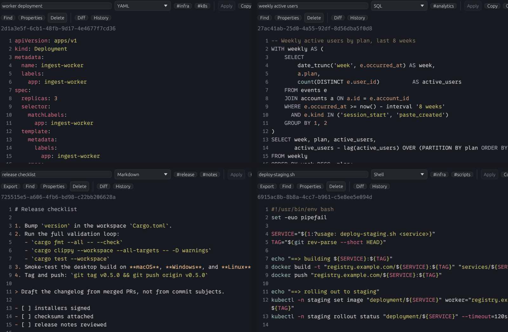

# Language Detection And Highlighting

Implementation roots:

- Core detection entrypoint: [`../crates/localpaste_core/src/detection/mod.rs`](../crates/localpaste_core/src/detection/mod.rs)
- Retrieval kinds, handles, and terms: [`../crates/localpaste_core/src/semantic.rs`](../crates/localpaste_core/src/semantic.rs)
- GUI highlight pipeline: [`../crates/localpaste_gui/src/app/highlight/mod.rs`](../crates/localpaste_gui/src/app/highlight/mod.rs), with its lifecycle described in [dev/highlighting.md](dev/highlighting.md)

## Feature Topology

- `localpaste_core` keeps `magika` as opt-in (`default = []`).
- `localpaste_gui` and `localpaste_server` enable `magika` by default.
- `localpaste_cli` sends content to the API; detection runs in the receiving GUI/server, not the CLI.

Magika builds download ONNX Runtime binaries, and inference runs on the CPU unless [`MAGIKA_FORCE_CPU`](security.md#environment-variables) is turned off. To use structural and heuristic detection without that dependency, disable the binary crate's default features:

```bash
cargo run -p localpaste_gui --bin localpaste-gui --no-default-features
# Or run the headless server with the same fallback:
cargo run -p localpaste_server --bin localpaste --no-default-features
```

## Detection Flow

For auto-detected language (`language_is_manual == false`), detection tries cheap structural checks first, then the Magika model, then heuristics:

1. Structural overrides run before any model inference: a paste that is a single standalone Markdown fence, a source shebang, Python compound statements, a leading Rust function or impl block, a colon-headed note such as `Agenda:` (labeled `markdown`), Makefiles, shell command sequences, and runtime output in any of the shapes listed under the [Log kind](#filter-and-search-semantics), labeled `log`.
2. With the `magika` feature, Magika classifies the body. CRLF is normalized to LF for inference only; stored content is unchanged. Non-text results and generic labels (`txt`, `randomtxt`, `unknown`, `empty`, `undefined`) are discarded. Any other label is normalized and [refined](#label-refinement), and a label that survives and is not `text` is the result.
3. Otherwise (Magika disabled, unavailable, failed, generic, or rejected by refinement), the heuristic fallback runs. Its label is normalized and returned unless it is empty or `text`.

Auto mode is a pending state rather than a continuously updated label. Switching a paste to Auto clears its resolved language, and the next content edit runs detection. Detection requires both at least 64 trimmed Unicode characters and at least 3 non-blank lines: until both minimums are met, the paste stays unresolved instead of locking a guess (`too_short_to_classify`, which `auto_detect_language` applies, in [`detection/mod.rs`](../crates/localpaste_core/src/detection/mod.rs)). A long single line or a tiny three-line snippet stays unresolved. The same minimum files a paste without a language under the [Short kind](#filter-and-search-semantics). Once detection resolves a concrete language, the paste is locked to it (`language_is_manual = true`) until it is switched back to Auto. API create requests that omit `language_is_manual` detect immediately when both minimums are met and lock when detection resolves; a request with `language_is_manual: false` and no `language` starts unresolved and defers detection to a later edit. A manual language is never re-detected on content edits.

Structural recognition is conservative where shapes overlap. A colon followed by indented lines can be a Makefile target, a Python compound statement, or a note, so each is accepted only when the whole sampled body supports it.

A `target:` line followed by tab-indented lines is claimed as a Makefile before model inference only when every indented line looks like a command: it names a known tool, uses a flag, path, variable, or shell operator, or it is a lowercase tool name followed by plain arguments, such as `zig build`. A recipe's `echo` line counts even when it prints a sentence, such as `@echo Building the app`. Makefiles for unfamiliar build tools therefore qualify, while stack traces, assembly, logs, and other tab-indented code keep their detected language. Distinctive Make syntax is enough on its own: `vpath`, a line that is one Make function call such as `$(info ...)`, `.mk` includes, and closed `define` blocks. Continued lines and `override` assignments count only alongside a target with command-shaped recipes.

Three document shapes look like Makefiles but are not. A chat transcript or labeled notes such as `ana: the deploy failed again` / `bob: which step?` have only `name: text` lines with no recipe, and the text after every colon reads as English by the prose-grammar rule below, while Make prerequisites are names; Magika's Makefile label is discarded for such a body. A note such as `Agenda:` followed by indented sentences or short items resolves to Markdown, unless prerequisites, a second target, directives, or command syntax show a real build file. Plain arguments are the weakest recipe evidence, so a single sentence-case label over plain-word lines, such as `Groceries:` over `flour sugar eggs`, is such a note too. Make's own target names are lowercase or all capitals, and a target named for the command it runs repeats that command's word, so `build:`, `ALL:`, and `Build:` over `zig build` keep the Makefile reading; the trade-off is that `groceries:` over the same items is still a Makefile. A README section keeps its document label when a capitalized label such as `Install:` sits under a Markdown heading, or when its only label is `Example:` or `Steps:`. When Magika itself reports a Makefile, only one of these complete document shapes changes the label; unfamiliar syntax alone does not.

Python compound statements (`if`, `for`, or `def` headers followed by indented bodies) can resemble targets with tabbed recipes as well. A body keeps its Python label while its sampled lines are consistently Python-shaped; unrelated targets, Make directives, unquoted shell variables, or command recipes anywhere in the sample disqualify it. An explicit source shebang takes precedence.

A `def` or `class` line counts as a Python definition, in detection and wherever a rule below looks for Python source, only in the shape Python requires: an identifier right after the keyword, then a function's parameter list or a class's optional bases, optionally after type parameters such as `[T]`, and the colon that ends the header, with only a `->` return annotation between a function's parameters and its colon. Whitespace between the name and header punctuation is allowed. A header whose brackets stay open at the end of the line continues on the next one. Simple groups of adjacent bare operands such as `(room 4)` are invalid; more complex expressions remain best-effort detection. A sentence such as `class is cancelled today: bring your notes` or `def foo(bar) is broken: see the log` therefore stays prose, including when indented reminders follow it. Compound-body anchors use the same `definition_header` check in [`detection/python.rs`](../crates/localpaste_core/src/detection/python.rs).

A lone Rust function such as `fn handle_request(input: &str) -> usize { ... }` has too few keywords for the heuristic scores, and Magika reports many such snippets as generic text and some, such as a function with a `where` clause or one returning an HTML string, as Swift or HCL. A paste is therefore labeled Rust before model inference when its first line, after blank lines, `//` comments, attributes, and `use` declarations, opens a `fn` item (with optional `pub`, `pub(crate)`, `const`, `async`, `unsafe`, or `extern` qualifiers and generics) or an `impl` block, a `{` opens a body, and the paste contains syntax that Zig, V, and Elixir, which also write `fn`, lack: a `->` return type, a `&` reference parameter or `self` receiver, a `::` path, `let mut`, a macro call such as `println!(`, or the `impl` header itself. Prose, Markdown, and log lines that quote a signature do not start with one, and an unindented sentence after the item marks a note rather than source. Rust-like languages that LocalPaste does not recognize, such as Gleam, are labeled Rust by the same rule. The check is `leading_item` in [`detection/rust.rs`](../crates/localpaste_core/src/detection/rust.rs).

Note-shaped bodies also correct the retrieval kind. A paste stored as Shell or Makefile whose body is a note, a Makefile-labeled chat transcript, or a prose sentence stored as JavaScript only because it contains `let` and `function`, derives the Document kind. The stored language and lock are untouched, so highlighting and export keep that choice; switching to Auto clears the label, and the next edit detects it again.

Magika's model loads lazily on first use and is shared by all callers. The GUI backend worker and the server call `prewarm()` at startup so the first save does not pay the load cost. If the model cannot initialize or an inference fails, detection falls back to the heuristics.

## Normalization Contract

Normalization maps legacy aliases and user-entered variants to stable labels (examples):

- `csharp`, `c#` -> `cs`
- `c++` -> `cpp`
- `bash`, `sh`, `zsh` -> `shell`
- `pwsh`, `ps1` -> `powershell`
- `yml` -> `yaml`
- `js` -> `javascript`
- `ts` -> `typescript`
- `md` -> `markdown`
- `tex` -> `latex`
- `restructuredtext`, `restructured text` -> `rst`
- `plaintext`, `plain text`, `plain`, `txt` -> `text`

Unknown values pass through in lowercase. `jsonl` stays distinct from `json`: the two share a highlighter but not a stored format, an export extension, or a language filter. The complete alias table is `canonicalize` in [`detection/canonical.rs`](../crates/localpaste_core/src/detection/canonical.rs).

Manual language picker values are defined centrally in `MANUAL_LANGUAGE_OPTIONS` and stored as normalized values.

## Filter And Search Semantics

The language label controls highlighting and export. Metadata search and the sidebar smart collections rely on a separate derived classification: each paste gets a kind (Document, Code, Config, Log, Link, Short, or Other), a short handle, and a few search terms. They are computed locally from the content and the stored language, persisted with the paste, and never change the language or its lock. The rules live in [`semantic.rs`](../crates/localpaste_core/src/semantic.rs) and its `semantic/` submodules; derived values are rebuilt through the [storage projection repair policy](storage.md#compatibility-policy) when the rules change.

Two principles run through the rules. The first is that the whole body outranks a single label. Auto-detection locks the labels it infers, so a stored label cannot be told apart from a user's choice, and a wrong one would misfile the paste: a log stored as `dockerfile`, or a shell session stored as `markdown`. Structural evidence in the body, such as a runtime header, a command sequence, or Python source, therefore wins. The second is that prose outweighs command evidence. A command must lead the paste with a recognized executable, such as `git`, `cargo`, `npm`, `grep`, `rsync`, or `ffmpeg` (the `COMMANDS` list in `crates/localpaste_core/src/semantic/commands.rs` covers build, file, text, archive, and cloud tools, but omits words that routinely open English sentences, such as `find`, `cat`, `head`, `which`, `open`, `sort`, and `touch`), or the setup builtins `cd`, `export`, `source`, and `set`, and none of its unquoted words may read as English: a function word (an article, pronoun, preposition, auxiliary, conjunction, or question word such as `the`, `my`, `on`, `is`, or `why`), a contraction such as `doesn't`, or sentence-ending punctuation attached to a word. Two dots are not punctuation but a Git range, so `git log main..` is a command. Options, paths, numbers, and operators never outweigh that evidence, because sentences mention them too, while quoted text is skipped, so `echo 'this is a test'` stays a command. A `git` line must name one of Git's own subcommands, and a setup builtin with plain operands such as `cd repo` counts only when a command follows it.

The words that `echo` and `printf` print are a message, not prose evidence, in two cases. A message that opens as a sentence of its own, with a capital letter, a quote, or a `$` expansion, is printed text: `echo Hello, world!` and `echo It's done` are commands, while `echo chamber is a common expression` and `echo what Sam said` continue an English sentence in lowercase, and `echo I think so` starts with the pronoun `I`. A message of any wording is printed text in a script, meaning a paste in which a listed command other than `echo` or `printf` stands on its own, as recipes print sentences under a Makefile target: `git pull` followed by `echo done deploying the app` is a script. Setup builtins do not make a script, so `cd app` followed by `echo chamber is a common expression` stays a note. The trade-off is that a sentence beginning with `echo` and a capitalized name, such as `echo Sam's point about the deadline`, reads as a command.

Shell control lines count as command lines in a sequence: `for host in web1 web2; do`, `while read -r line; do`, `if [ -f .env ]; then`, `else`, `case "$1" in` with its `start) ... ;;` items, and the closing `done`, `fi`, and `esac`. They are recognized only when their blocks open and close in order and their headers have a loop variable or a condition without English grammar, so `if you see errors, call me` and `for the record, ...` are still prose. Commands inside a block must be command lines themselves, except in a paste that is entirely one `for` loop, whose body may run any tool.

A body that continues with a prose sentence after its leading command is a note quoting that command, unless a `$ ` or `% ` prompt marks it as a terminal transcript; command lines and control lines are never that sentence. The trade-off is that a command followed by its unprompted output reads as a note when the output contains a sentence, so `git status` followed by `nothing to commit, working tree clean` needs the `$ ` prompt to stay Code.

The kinds:

- **Document.** Markdown, reStructuredText, LaTeX, and unlabeled prose, meaning several words that are mostly letters with little punctuation. A Markdown label alone is not enough; the body must read as a document. A document can quote code, commands, or log lines without changing kind: `The --release option optimizes the build.` is a Document, and so is a Markdown note headed `# Log notes` that quotes an `[INFO]` line. A paste that is a single fenced block is classified by the fence instead of the Markdown wrapper: a `python` or `sh` fence is Code, a `json` fence is Config, a `text` fence holding log output is a Log, and a `text` fence holding prose is a Document. A fence surrounded by prose, or one that wraps Markdown, stays a Document.
- **Code.** Source in a recognized programming language, bodies that lead with a command, and shell command sequences, including loops and conditionals. `git rev-parse HEAD` and `cd repo && git status` are Code, with handles such as `git rev-parse`; a note that mentions `git` halfway through is not, and neither is `cargo build takes forever on my laptop` or a commit message whose subject reads like a command but whose body is prose. Rust, Python, JavaScript, TypeScript, and Go source also gets definition handles such as `fn handle_request`.
- **Config.** JSON, JSONL, YAML, TOML, XML, Dockerfile, and Makefile content, plus unlabeled `key: value` bodies using well-known keys such as `name`, `model`, or `image`. A YAML paste containing `model: gpt-4` is Config with the handle `model gpt-4`.
- **Log.** Runtime output, recognized by line structure rather than vocabulary, so a note that mentions a panic, a stack trace, or an error budget stays a Document. The recognized shapes are:
  - Timestamped lines. A line counts when it starts with a timestamp that includes seconds: a date and time such as `2026-10-10T06:00:01Z`, `2026-10-10 06:00:01.123`, or `2026/10/10 06:00:01+02:00`, with an optional fraction and zone and optionally in brackets, or syslog's `Oct 10 06:00:01`. At least half of the unindented lines must start with one, so indented stack frames do not count against a log, and a single stamped line needs a spaced uppercase or bracketed level after the timestamp, such as ` INFO ` or `[INFO]`. A comma or tab right after the timestamp marks a record field, so a CSV or TSV whose first column is a time stays Other, and a date without seconds is not a timestamp. The one comma that belongs to the timestamp is the one Python logging and log4j print before milliseconds: exactly three digits followed by the message or a closing bracket, as in `2026-10-10 06:00:01,423 INFO Starting`. A row such as `2026-10-10 06:00:01,42` or one ending in `,423` is a record.
  - Level-prefixed lines such as `[INFO] Server started`, `INFO Starting the server`, `error: unable to open database`, `INFO:root:Starting`, npm's `npm ERR!` and `npm WARN` lines, and yarn output. Lowercase level words are also ordinary English (`debug crash in auth/login.rs`) and mapping keys (`info: version 1.2`), and to-do items and mapping values name paths, versions, and files as often as output does. Two or more lowercase levels at the start of a paste therefore need evidence that only tool output has: a `yarn` banner, a `[1/4]` progress step, a progress ellipsis (`info Fetching packages...`), or, after `level:`, a message that cannot be a mapping value because it holds a second `label: ` or a backtick code span, as compiler and Git diagnostics do (`error: unable to open file: /tmp/x`, ``warning: unused import `std::io` ``). Without such evidence the lines are a to-do list, glossary, or mapping: detection does not label them `log`, and a stored config label such as YAML, TOML, or JSON keeps the Config kind. A `key: value` line whose value is a single token or one quoted string is a mapping entry and gives no evidence at all, so `error: /var/log/error.log` followed by `info: /var/log/info.log` stays a mapping. After a timestamp, lowercase levels are ordinary output under the timestamp rule, as Go and Node loggers print them (`2026-10-10T06:00:01Z info: server listening on :8080`).
  - A Rust panic header that leads the paste, alone or after Cargo's status lines (`Compiling demo v0.1.0`, `Updating crates.io index`), whatever follows it. A panic elsewhere in the paste is crash output, below.
  - rustc diagnostics such as `error[E0308]: mismatched types` followed by a `-->` location, and Java stack traces with an `at Class.method(File.java:12)` frame.
  - Crash output. Its anchor is a Python traceback (the `Traceback (most recent call last):` header, a `File "...", line N` frame, and the exception line, with any chained tracebacks between), a Rust panic (the `thread 'main' panicked at src/main.rs:4:5:` header, the message on the next line when the header ends in `:`, and every line through the last `note: `, `stack backtrace:`, or Cargo `error: process didn't exit successfully` line after it, so backtrace frames belong to it; a header with none of these after it is only a quoted line), or a line reporting how a process ended: a fatal signal such as `Segmentation fault (core dumped)`, macOS's `Segmentation fault: 11`, zsh's `zsh: segmentation fault  ./a.out`, or `Killed`, or an exit status such as `exit code 1`, `exit status 2`, or `Process finished with exit code 1`. The traceback or panic may start anywhere, after training output, timestamped or level-prefixed service logs, a `$ python train.py` prompt, or a `>>> 1/0` line typed at the Python prompt, so crash output outranks the `$ ` transcript rule that would otherwise make the paste Code, and a REPL session that ends in a traceback is a Log. Every line outside the anchor must be output rather than source or commentary. Source is a Python definition or import line (`def div(a, b):`, `import pytest`) or a Rust item definition (`fn main() {`, `impl Server {`), so a function whose docstring holds a doctest traceback, a test that compares output with an expected traceback or panic, or a Rust program followed by the panic it prints stays Code; a frame's own source line, such as `import torch` inside the traceback, is part of the anchor, and a line typed after the `>>> ` prompt is not source. Commentary is a `#` heading or comment, or a line with English grammar that asks a question, speaks in the first or second person (`Getting this error when I run train.py:`), or is a whole sentence ending in `.`, `!`, or `:`, so a bug report that quotes a traceback or panic stays a Document, and a note that merely names a traceback or a segmentation fault has no anchor. Program status lines read as English too (`Starting server on port 8080`) but are none of these, and labeled runtime lines (`UserWarning: ...`, `wandb: ...`), prompts, and progress lines with an ellipsis are never commentary. The trade-off is that a status line printed as a full sentence (`Saved the checkpoint to disk.`) makes the paste read as a note.

  Runtime structure overrides an incidental Code, Config, or Markdown label, including a locked one. Source followed by the output it prints stays Code, because its definition lines are source rather than output.
- **Link.** A body that is a single URL. `https://example.com/docs` is a Link with the handle `example.com`.
- **Short.** A paste without a language whose content is below the [auto-detection minimum](#detection-flow). A few words are too little evidence to tell a note from a command or a mapping, so the rules above do not guess a kind for it: `hello new paste`, `if ready:` over an indented `result = 1`, `def main():` over an indented `pass`, and `debug: True` over `trace: False` are all Short, and so is an empty paste. Two shapes are certain at any length and keep their kinds: a single URL is a Link, and runtime output that the structural Log shapes recognize on their own is a Log, such as a timestamped line with a level (`2026-10-10 06:00:01 INFO starting scheduler`), a Rust panic header, or `Segmentation fault (core dumped)`. A single level-prefixed line without a timestamp, such as `[INFO] Server started`, is Short. A short paste with a language, whether the user picked it, an API create supplied it, or an older row holds a locked label, keeps the kind its language gives, so `fn main() {}` stored as Rust is Code and a short note stored as plain text is a Document. Once an edit brings the content to the minimum, the rules above classify it.
- **Other.** Everything else the rules above do not claim: hexadecimal blobs, delimited tables such as TSV, and a single word such as `hi` stored as plain text.

The sidebar collections Documents, Code, Config, Logs, Links, and Short filter on these kinds. Language, title, and tags can also place a paste in Code, Config, Logs, or Links, so a paste named `deploy.log` appears under Logs even when its body is unremarkable, and a paste of kind Other or Short appears in none of those four unless that metadata points to one. Short lists exactly the pastes of kind Short. A Log appears only under Logs. A Document appears under Documents unless an explicit signal (a file suffix, a command-style, `Dockerfile`, `Makefile`, or URL title, a language label, or a whole-word tag) moves it to Code, Config, Logs, or Links, so a note titled `holographic otter` is not mistaken for a log.

Classification reads a bounded leading sample of the body, ending on a line boundary so a partly included row cannot change the result. Very large pastes are therefore classified from their opening content.

Handles are short labels for the sidebar tooltip and metadata search. The first rule that applies wins: a definition in Rust, Python, JavaScript, TypeScript, or Go (`fn handle_request`), named by its keyword and name with qualifiers skipped, so `pub(crate) fn helper` and `pub async fn fetch` get `fn helper` and `fn fetch`, `async def fetch` gets `def fetch`, and `func (s *Server) Handle` gets `func Handle`, while JavaScript and TypeScript keep `export` (`export async function load` gets `export function load`); the leading command with its first operand (`git rev-parse`, `cd ~/projects/app`), a well-known config key with its value (`model gpt-4`, `dataset /data/train/v2`), the host of a single URL (`example.com`), for a Log the first two search terms of its first line with a spaced uppercase or bracketed level (after any timestamp), in reading order, and otherwise the first two search terms. The Log rule names the first record the log holds, as a command handle names the first command: `2026-10-09T14:02:11.384Z  INFO checkout::api: POST /v1/orders` gets `info checkout::api`, and `2026-10-10 06:00:01 INFO starting scheduler` gets `info starting`, where the most repeated terms of a log ending in a backtrace would be a source location and a path component such as `src`. A lowercase `error:` or `warning:` line is a tool's diagnostic rather than a record, so a log without uppercase or bracketed levels, such as a lone panic, compiler diagnostics, or a syslog excerpt, gets the first two search terms. Handles are capped at 48 characters (`MAX_HANDLE_CHARS`). Command operands and config values are copied from the paste, never edited: the text is read up to the first character that is not a letter or digit in any script or one of `_ - . : / \ ~ @ + ,`, so a path keeps its slashes, `name: café-münchen-projekt` keeps its accents, and `ls *.txt` gets the handle `ls`, not a string that never appeared in the paste. `=` ends the text as well, because what follows it is an assigned value that is often a secret: `export API_KEY=...` gets the handle `export API_KEY`, and `name: token=...` gets `name token`. Surrounding quotes and a trailing comma are dropped. A command operand is a single whitespace-delimited word, but a config value may hold several, so it also accepts spaces, which collapse to one: `name: My Project` gets `name My Project`, and `name: web # prod` gets `name web`. Both are capped at 24 characters (`MAX_HANDLE_ATOM_CHARS`) by keeping their start, and like the 48-character handle cap this counts characters, so a cut never splits a non-ASCII letter, and a config value keeps whole words under the cap, cutting mid-word only when its first word alone is longer. A config key must match a well-known key exactly, so `service is down: restart it` is not a config entry.

Search terms come from the same sample: up to four word-like tokens, preferring repeated and identifier-shaped ones. A token is a run of letters and digits in any script plus `_`, `-`, `:`, and `.`; emoji, symbols, and other punctuation separate tokens, so `naïve café ☕` yields `naïve` and `café`. Scripts written without spaces, such as Chinese and Japanese, form one token per run between punctuation marks, so a short run such as `日本語` is a term while a long unpunctuated sentence exceeds the length cap below and is dropped. Terms are lowercased with full Unicode case mapping, so `ÉCOLE` is stored as `école`. Punctuation is trimmed from both ends of each token before it is judged: leading and trailing `.`, `:`, and `-` are removed, so `deploy.`, `name:`, and `--release` count as `deploy`, `name`, and `release`, while internal punctuation stays (`localpaste.rs`, `v1.2.3`, `hash_map::entry`, `kebab-case`). Underscores are not trimmed because they belong to identifiers such as `__init__` and `_private`. The URL scheme words `http`, `https`, and `www`, like other stopwords, never become terms. After trimming, a token must be 3 to 48 characters long (`MAX_TERM_CHARS` in `semantic.rs`, matching the 48-character handle cap) to qualify; both limits count characters, not bytes, so a 30-letter word of accented letters qualifies and the two-letter `éé` does not. A longer token, such as a minified line or a base64 blob, is dropped rather than truncated, because a prefix of it is not a meaningful term; a handle synthesized from terms therefore cannot be built from one either. Body search still finds such strings. Realistic identifiers such as `std::collections::hash_map::entry` or `HIGHLIGHT_DEBOUNCE_LARGE_BYTES` fit well within the cap. A term must also contain at least one letter in any script other than the ISO 8601 designators: the `T` between a date and a time, which has a digit on both sides, and the `Z` that ends a UTC time after a digit. Dates, times, versions, and addresses written only in digits, punctuation, and those designators (`2026-10-10`, `06:00:01`, `14:02:11.384`, `2026-10-09T14`, `2026-10-09T14:02:11.384Z`, `2026-10-09T14:02:11-05:00`, `20261009T140211Z`, `1.2.3`, `127.0.0.1`) are not terms, so a timestamped log or a CSV with a time column gets a handle from its words (`info starting`, `count`) rather than `2026-10-10 06:00:01`; body search still finds them. A single other letter is enough, so `E0308`, `v1.2`, `node-04`, and `t3.micro` remain terms, and so do source locations such as `client.rs:212:38`, which metadata search matches by substring when the query is `client.rs`.

Metadata search compares a query against names, tags, handles, and terms. The whole query is matched as lowercase text, and it is also split into parts at every character other than a letter, digit, `_`, or `-`, so each part of a dotted or path-like query can match on its own; parts shorter than two characters are ignored. Each part is normalized by the same function as stored terms (`normalize_term` in `semantic.rs`): edge punctuation is trimmed and Unicode lowercasing applied, so `--release`, `Note:`, and `Café` find the terms `release`, `note`, and `café`. Case-sensitive search trims the parts but keeps their case, so it compares them with terms exactly as stored.

Language filters and metadata search normalize both the stored and the requested value with the [same rules](#normalization-contract), so a filter of `cs` also lists pastes stored as `csharp`.

## Text Export Extensions

[`preferred_extension`](../crates/localpaste_core/src/detection/extensions.rs) maps each recognized text format to its conventional extension, independently of highlighting grammar support: `zig` exports as `.zig` even though it renders as plain text. CSV and TSV export as `.csv` and `.tsv`. JSON Lines exports as `.jsonl` and shares JSON highlighting; because Magika reports both JSON and JSON Lines under either of its JSON labels, detection chooses `jsonl` when the body holds multiple valid line records. Markdown, reStructuredText, and LaTeX export as `.md`, `.rst`, and `.tex`. Unknown formats use `.txt`. Export writes the current editor content unchanged.

## GUI Highlight Resolution



The editor converts a stored language label into a syntect grammar. `syntect_language_hint` normalizes the label first, so `bash` and `sh` both reach `shell`, and `jsonl` borrows the JSON grammar while remaining JSONL in storage. `markdown` resolves to the project-owned [LocalPaste Markdown grammar](../crates/localpaste_gui/assets/LocalPaste-Markdown.sublime-syntax), in which fenced code is drawn in a single code color rather than highlighted in the fence's language, and `text` and its aliases resolve to plain text. Any other label is tried in this order:

1. exact syntax name
2. exact extension
3. case-insensitive name
4. normalized-name match (alphanumeric only)
5. case-insensitive extension scan
6. explicit fallback candidates for known mismatches
7. plain text

The fallback table is deliberately small. A few high-priority labels borrow a nearby grammar (for example `typescript`, `toml`, and `powershell`), but labels without a bundled grammar, such as `zig`, `kotlin`, and `dart`, render as plain text rather than with misleading tokenization. Their metadata labels stay visible in filters and export.

The fallback candidates live in `syntax_fallback_candidates` in [`syntax.rs`](../crates/localpaste_gui/src/app/highlight/syntax.rs), and `resolver_tests` in [`worker.rs`](../crates/localpaste_gui/src/app/highlight/worker.rs) cover both the borrowed-grammar and the plain-render cases.

## Virtual Editor Async Highlight Flow

Highlighting runs on a background thread. While the user types, the previous colors stay in place, and a new result replaces them only after a short pause in editing, so colors do not flicker mid-burst. Buffers of 256 KiB or more (`HIGHLIGHT_PLAIN_THRESHOLD` in [`app/mod.rs`](../crates/localpaste_gui/src/app/mod.rs)) are not highlighted at all: the editor draws them as plain text, and list rows (sidebar, paste picker, Diff candidates) and History snapshots show their language as `plain`. The stored language is unchanged.

Request, debounce, and staging mechanics are described in [dev/highlighting.md](dev/highlighting.md).

## Label Refinement

Magika also reports short notes, headers, and prose as structured formats, so its label is checked against the body before it is accepted. A rejected label falls through to the heuristics. The checks are implemented in `refine_magika_label` in [`detection/mod.rs`](../crates/localpaste_core/src/detection/mod.rs):

- Markdown: a label on a body that is wholly commands or a Makefile (relabeled `shell`), runtime output, or Python source is replaced by the matching language. A standalone fence is always Markdown.
- Makefile: relabeled Python for compound Python bodies and Markdown for note bodies, and rejected when every rule reads as prose.
- Python: dropped when prose or Markdown document evidence contradicts the label, including invalid `def` or `class` headings.
- YAML: accepted only with YAML-distinctive structure (see below).
- SCSS: relabeled CSS when the body has no SCSS-specific syntax.
- gitattributes: requires a path pattern with attribute tokens or recognized attribute assignments, so short clipboard prose does not qualify.
- Batch: rejected for prose such as a sentence beginning with `set`, `export`, or `source` whose arguments lack setup-command structure (an assignment, option, or path operand; see `setup_command_is_valid`), or one with `in`, `at`, or `by` before a later path. A stored Batch label on such prose derives the Document kind.
- JSON and JSON Lines: split by checking for multiple valid line records.

These refinements apply during detection only; manual stored language values are never rewritten.

A mapping-heavy sample must show YAML-distinctive structure before it is accepted as YAML. Single-line and prose-like flat mappings stay ambiguous because they also match notes, logs, and email or HTTP headers. YAML is accepted when the sample has a document marker, nested indentation, flow collections, block scalars, anchors, structured sequence items, or multiple config-shaped flat mapping lines.

## Validation Targets

When touching detection or highlighting, run the core detection and semantic tests (`localpaste_core::detection::tests`, `localpaste_core::semantic::tests`), the [GUI highlight tests](dev/highlighting.md#tracing-and-validation), the [Language/Highlight QA](dev/gui-notes.md#languagehighlight-qa-magika--fallback) checklist, and the [perf checks](dev/gui-perf-protocol.md).
